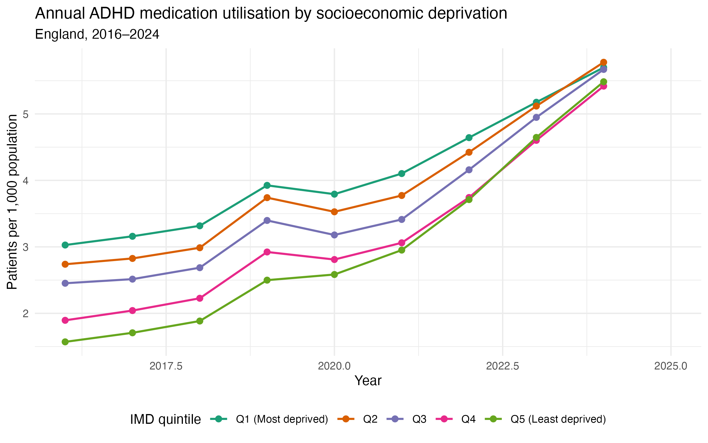
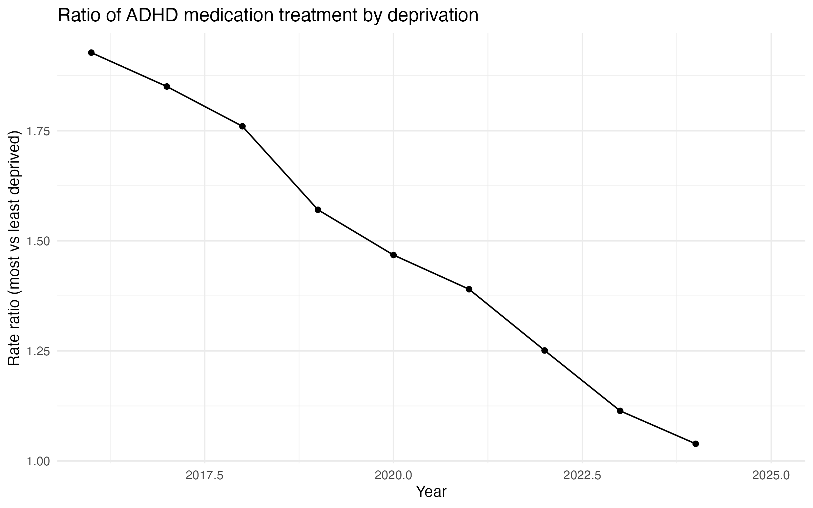

# A Closing Gap? Socioeconomic Deprivation and ADHD Medication Use in England, 2016–2024

**Author:** Una Ahn · Independent research project, 2026

---

## Summary

This analysis looked at how the rate of people receiving ADHD medication in England changed between 2016 and 2024 across area-level deprivation quintiles (IMD2025).

- In 2016, treatment rates followed a clear deprivation gradient. The most deprived quintile (Q1) had about **twice** the rate of the least deprived quintile (Q5): 3.03 vs 1.57 per 1,000.
- Rates rose in every quintile, but growth was steepest in the least deprived areas (model-estimated average of **17.2% per year** in Q5 vs **8.2%** in Q1).
- By 2024 the gradient had largely disappeared. Rates ranged from 5.42 to 5.78 per 1,000 across quintiles, and the Q1/Q5 rate ratio fell to **1.04**.
- Each quintile's rate grew more slowly than the least deprived quintile's (Q1 vs Q5 interaction IRR 0.92, 95% CI 0.91–0.94). This result was unchanged in a sensitivity analysis that modelled the time trend differently, and after indirect age standardisation.
- Age structure explained part of the 2016 gradient (age-adjusted Q1 vs Q5 rate ratio 1.60), but not the convergence over time.

Because ADHD is reported to be more common in more deprived groups, similar treatment rates do not necessarily mean equal treatment relative to need (see [Discussion](#discussion)).

---

## Data

| Source | Use |
|---|---|
| NHSBSA, *Medicines Used in Mental Health – England*, BNF section 4.4 (CNS stimulants and drugs used for ADHD), IMD breakdown | Numerator: identified patients by calendar year and IMD quintile |
| ONS, *Lower layer Super Output Area population estimates* (mid-2011 to mid-2022; mid-2022 to mid-2024 editions), 2021 LSOAs | Denominator: mid-year population |
| MHCLG, *English Indices of Deprivation 2025*, File 1 (IMD2025) | IMD decile for each 2021 LSOA |

NHSBSA assigns each patient to an IMD2025 quintile based on their postcode, or the prescribing practice's postcode when the patient postcode is unavailable. All identified patients in the study period were assigned an IMD quintile, so no patients were excluded for unknown deprivation status.

Each English 2021 LSOA (33,755) was assigned its IMD2025 decile. Deciles were grouped into quintiles, and populations were summed by year and quintile. IMD2025 was applied to all years so that numerators and denominators use the same deprivation classification and geography.

---

## Methods

**Design:** ecological time-series analysis, 45 observations (9 years × 5 quintiles).

**Descriptive measures:** crude treatment rate per 1,000 population; absolute inequality (rate difference, Q1 − Q5) and relative inequality (rate ratio, Q1 ÷ Q5) for each year.

**Regression:** patient counts were modelled with log(population) as an offset, so exponentiated coefficients are incidence rate ratios (IRRs). Q5 is the reference group, and year is centred on 2016.

1. **Choice of model.** A Poisson model with an IMD × year interaction showed substantial overdispersion (residual deviance 15,410 on 35 df; ratio ≈ 440, compared with ≈ 1 expected under the Poisson assumption), so negative binomial models were used.
2. **Model selection.** Starting from a negative binomial model with IMD quintile and linear year, terms were added in sequence and compared with likelihood ratio (LR) tests and AIC:
   - an IMD quintile × linear year interaction (does the deprivation gap change over time?)
   - a common quadratic year term (is the overall time trend curved?)
   - quadratic terms varying by quintile (do quintiles follow different curves?)

   The **final model** included IMD quintile, linear year, their interaction and a common quadratic year term.
3. **Sensitivity analysis:** the time trend was replaced with year as a categorical variable, keeping the IMD × linear year interaction, to check that the inequality result did not depend on how time was modelled.
4. **Age adjustment (indirect standardisation):** NHSBSA does not publish patient counts by age and IMD together, so rates were indirectly age-standardised. National treatment rates for each year and broad age group (0–15, 16–29, 30–44, 45–64, 65+) were applied to each quintile's population in those age groups (ONS) to give an expected count. The final model was refitted with log(expected count) as the offset, giving age-adjusted IRRs. Because each year's own national rates were used, this also accounts for changes over time in which age groups are treated.

Analysis was done in R (tidyverse, readxl, MASS, broom, here). Code is in this repository.

---

## Results

### Treatment rates by deprivation

*Figure 1. Patients receiving ADHD medication per 1,000 population by IMD quintile, England, 2016–2024.*

**Table 1. Observed treatment rates per 1,000 population**

| IMD quintile | 2016 | 2017 | 2018 | 2019 | 2020 | 2021 | 2022 | 2023 | 2024 |
|---|---|---|---|---|---|---|---|---|---|
| Q1 (most deprived) | 3.03 | 3.16 | 3.32 | 3.93 | 3.79 | 4.10 | 4.64 | 5.18 | 5.70 |
| Q2 | 2.74 | 2.83 | 2.99 | 3.74 | 3.53 | 3.77 | 4.42 | 5.12 | 5.78 |
| Q3 | 2.45 | 2.51 | 2.69 | 3.40 | 3.18 | 3.41 | 4.16 | 4.95 | 5.67 |
| Q4 | 1.89 | 2.04 | 2.23 | 2.92 | 2.81 | 3.06 | 3.74 | 4.60 | 5.42 |
| Q5 (least deprived) | 1.57 | 1.71 | 1.88 | 2.50 | 2.58 | 2.95 | 3.71 | 4.65 | 5.48 |
| **Rate ratio (Q1 ÷ Q5)** | **1.93** | **1.85** | **1.76** | **1.57** | **1.47** | **1.39** | **1.25** | **1.11** | **1.04** |
| **Rate difference (Q1 − Q5)** | **1.46** | **1.45** | **1.43** | **1.43** | **1.21** | **1.15** | **0.93** | **0.53** | **0.21** |

*Figure 2. Ratio of treatment rates in the most deprived (Q1) to the least deprived (Q5) quintile, England, 2016–2024. The dashed line marks equal rates.*

In 2016, treatment rates fell steadily from the most to the least deprived quintile. Rates increased in every quintile over the period, but the increase was largest in the least deprived areas. By 2024, Q5's rate was 3.5 times its 2016 level (from 1.57 to 5.48 per 1,000), compared with 1.9 times in Q1 (from 3.03 to 5.70 per 1,000). The rate ratio fell every year, from 1.93 to 1.04 (Figure 2), and the rate difference fell from 1.46 to 0.21 per 1,000. By 2024 the quintiles had largely converged: Q2 had the highest rate (5.78) and Q4 the lowest (5.42).

All quintiles rose sharply between 2018 and 2019. In 2020, rates fell slightly in Q1–Q4 but continued to rise in Q5. Growth was fastest from 2021 onwards.

### Regression

**Table 2. Negative binomial regression, final model: crude and age-adjusted incidence rate ratios (95% CI)**

| Term | Crude IRR | Age-adjusted IRR |
|---|---|---|
| *IMD quintile, 2016 (ref: Q5)* | | |
| Q1 (most deprived) | 2.00 (1.84–2.17) | 1.60 (1.50–1.71) |
| Q2 | 1.78 (1.64–1.93) | 1.57 (1.46–1.67) |
| Q3 | 1.56 (1.44–1.70) | 1.49 (1.39–1.59) |
| Q4 | 1.23 (1.14–1.34) | 1.22 (1.14–1.30) |
| *Annual rate of change relative to Q5 (IMD × year)* | | |
| Q1 (most deprived) | 0.923 (0.907–0.939) | 0.924 (0.911–0.937) |
| Q2 | 0.936 (0.920–0.952) | 0.934 (0.921–0.947) |
| Q3 | 0.947 (0.931–0.963) | 0.944 (0.931–0.958) |
| Q4 | 0.970 (0.954–0.987) | 0.968 (0.955–0.982) |

*All crude IRRs shown had p < 0.001. The crude model uses log(population) as the offset; the age-adjusted model uses log(expected count). Intercept, linear year and quadratic year terms describe the shared time trend and are not shown.*

In the crude model, treatment rates in the most deprived quintile were twice those in the least deprived in 2016 (IRR 2.00, 95% CI 1.84–2.17), and rates fell steadily across the quintiles. The IMD × year interaction IRRs were all below 1, so each quintile's treatment rate grew more slowly than Q5's. Growth was slowest in the most deprived quintile, and the interactions followed the deprivation gradient. An interaction IRR of 0.923 for Q1 means the Q1:Q5 rate ratio shrank by about 8% each year, to roughly half its 2016 value over eight years (0.923⁸ ≈ 0.53). In terms of the model's fitted rates, treatment grew by an average of 17.2% per year in Q5, compared with 13.7% in Q4, 11.0% in Q3, 9.7% in Q2 and 8.2% in Q1.

**Table 3. Model selection (likelihood ratio tests)**

| Comparison | Term(s) added | LR χ² | df | p |
|---|---|---|---|---|
| Main effects vs interaction | IMD × year | 42.4 | 4 | < 0.001 |
| Interaction vs + quadratic | Common quadratic year | 19.3 | 1 | < 0.001 |
| + quadratic vs quadratic by quintile | IMD × year² | 1.19 | 4 | 0.88 |

Allowing the rate of change to differ by quintile improved model fit significantly, as did a common quadratic year term. A quadratic term varying by quintile gave no further improvement. The final model therefore included IMD quintile, linear year, their interaction and a common quadratic year term. The quadratic term was positive (IRR 1.01 per year², p < 0.001), indicating that growth accelerated over the period in all quintiles.”

### Age adjustment

Adjusting for age reduced the 2016 deprivation gradient, mainly in the most deprived quintile (Table 2): Q1's rate ratio fell from 2.00 to 1.60, so roughly a third of the excess on the log scale was explained by differences in age structure. A clear gradient remained after adjustment, with all quintiles above Q5 and confidence intervals excluding 1. The interaction IRRs were almost unchanged (Q1: 0.923 crude vs 0.924 adjusted), so the convergence between quintiles over 2016–2024 was not explained by differences in age structure or by shifts in which age groups were treated.

### Sensitivity analysis

When year was modelled as a categorical variable, the IMD × year interaction IRRs were the same as in the main model to three decimal places (Q1 vs Q5: 0.923, 95% CI 0.919–0.927; Q4 vs Q5: 0.970, 95% CI 0.966–0.975). The findings were therefore not sensitive to how the time trend was specified. Confidence intervals were narrower in the sensitivity model because year-specific terms absorb year-to-year variation in the overall trend, so the wider intervals from the main model are reported as the primary results.

---

## Discussion

### Main findings

Between 2016 and 2024, ADHD medication use in England rose across all levels of area deprivation. The rise was concentrated in less deprived areas, so a treatment gradient in which treatment rates were highest in the most deprived areas largely disappeared.

### Interpretation

**How the gap closed.** Inequality narrowed because rates in less deprived areas caught up, not because rates in deprived areas fell. Treatment in the most deprived quintile rose by 88% over the period. However, the least deprived quintile's rate rose much faster, to 3.5 times its 2016 level, and by 2024 it had almost reached the rate in the most deprived areas. In absolute terms, the least deprived quintile gained 3.91 treated patients per 1,000 people over the period, compared with 2.67 per 1,000 in the most deprived, so a larger share of the additional treatment went to less deprived areas.

**Convergence and equity.** Equal treatment rates are only equitable if the need for treatment is also equal. In the UK Millennium Cohort Study, families of children with ADHD were more likely to live below the poverty line than other families. This association disappeared once children's symptom levels were taken into account, which indicates that it reflects a real difference in symptoms, not over-diagnosis in poorer families (Russell et al., 2014). Using the same cohort and Scottish administrative data, Pearce et al. (2024) found that ADHD symptoms by age 7 were reported for 55.7% of children whose mothers were economically inactive, compared with 23.4% of children of mothers in managerial or professional jobs. Diagnosed ADHD is similarly concentrated in deprived groups, where in a Welsh cohort of women born in 1991–1998, 39.9% of those diagnosed in childhood lived in the most deprived quintile, compared with 28.1% of those without a diagnosis (Wilson et al., 2026).  There is also evidence that disadvantaged children are less likely to move from diagnosis to treatment. Among diagnosed children in the Millennium Cohort Study, 44.1% of those with economically inactive mothers received medication, compared with 84.9% in the intermediate occupational group (Pearce et al., 2024). If need is higher in deprived areas, similar treatment rates in 2024 would mean that people in those areas are now less likely to be treated relative to need. That would be a widening of inequity, even though the measured gap has closed.

The age-adjusted results point in the same direction. Differences in age structure explained about a third of the 2016 gradient, but adjusting for age did not change how quickly the gap closed. The gap therefore closed at the same speed from a smaller starting point. So once age is taken into account, the most deprived areas end the period in a weaker relative position than the crude rates suggest.
 
**Possible explanations.** This analysis cannot identify why treatment grew faster in less deprived areas, but several explanations are plausible and could be tested in future work.

The first concerns routes to assessment. Waits for NHS assessment are long: in England, children waited an average of 2 years 5 months from referral to an ADHD diagnosis in community health services, and 23% waited more than four years (Children's Commissioner for England, 2024). Families interviewed for the same report said those who could pay for a private assessment received help much more quickly. Little is known about who uses the Right to Choose pathway, which allows NHS-funded assessment by independent providers. If private and Right to Choose routes are used more by people with more money, time, or confidence in dealing with the health system, they would add treatment disproportionately in less deprived areas. 

The second explanation concerns who seeks diagnosis. In UK primary care between 2000 and 2018, new ADHD diagnoses rose about 20-fold in men and 15-fold in women, much faster than in children (McKechnie et al., 2023). Because the age adjustment here used each year's national age-specific rates, the shift of treatment towards adults does not on its own explain the convergence, but adults in less deprived areas may have driven more of that shift. Finally, in 2020, rates fell slightly in the four most deprived quintiles but continued to rise in the least deprived. This is consistent with COVID-19 disrupting care more in deprived areas, although a single year is not enough to show this.

### Comparison with previous research

Earlier UK studies found that ADHD diagnosis and prescribing were concentrated in more deprived areas. Using primary care records for 7.7 million people from 2000 to 2018, McKechnie et al. (2023) found that the most deprived quintile had about two to three times the rate of new ADHD diagnoses of the least deprived, and nearly twice the rate of prescribing. The crude rate ratio of 1.93 observed here in 2016 matches that earlier pattern closely. This study shows that the gradient did not persist: from 2016 to 2024 it narrowed every year, and by 2024 it had almost disappeared.

Khan and Hasan (2025) analysed ADHD medication prescribing across England's 42 integrated care boards (ICBs) from 2019/20 to 2023/24. National prescribing rose from 25.17 to 41.55 items per 1,000 population, an average increase of about 18% per year, and ICBs with a higher proportion of residents in the most deprived decile had higher prescribing rates. Both studies show steep growth, and growth in the least deprived quintile here (about 17% per year from 2019 to 2024) is similar to their national figure. The studies differ in three ways that affect what each can show:

- **Change over time.** Khan and Hasan treated deprivation as a fixed characteristic of each ICB and did not test whether the gap changed. An association averaged over 2019–2024 could hide a gradient that was weakening over the same period, which is what this study found.
- **Geographic detail.** ICBs are large and contain both affluent and deprived neighbourhoods. Here, deprivation was assigned at the level of small areas, which reduces the risk of averaging out differences within an ICB.
- **What is counted.** Khan and Hasan counted prescription items, which reflect both the number of patients and how often each is prescribed. This study counted identified patients, which is closer to access to care. The two growth rates are therefore not directly comparable.

### Limitations

- **Ecological design.** Associations are at area level and may not apply to individuals.
- **Age adjustment was indirect and coarse.** NHSBSA does not publish age by IMD, so rates were indirectly standardised using five broad age groups. The 0–15 group combines ages with very different treatment rates, and 15-year-olds fall in different groups in the NHSBSA and ONS data, so some confounding by age may remain. Sex was not adjusted for.
- **Retrospective IMD.** IMD2025 was applied to all years, so areas are classified by their mid-2020s deprivation. Areas whose relative deprivation changed since 2016 will be misclassified in earlier years.
- **Assignment of deprivation.** Some patients were assigned to an IMD quintile by their practice postcode instead of their own.
- **Non-independent observations.** Yearly counts within a quintile are correlated, so p-values are likely overstated. Interpretation relies on effect sizes and their consistency across models.
- **Private prescriptions are not included.** The NHSBSA data cover only NHS prescriptions dispensed in the community. People prescribed privately are missing from the counts. If private treatment is more common in less deprived areas, treatment there is underestimated, and the true convergence may be greater than shown.
- **Unexplained rise in 2019.** All quintiles rose sharply between 2018 and 2019 (by 33% in Q5 and 18% in Q1). The cause was not established, and it may partly reflect changes in how NHSBSA identifies patients. Because it affected all quintiles, it is unlikely to explain the narrowing of the gap.

---

## Conclusion

Between 2016 and 2024, ADHD medication use in England grew in every deprivation quintile, but it grew fastest in the least deprived areas. As a result, a gradient in which the most deprived areas had about twice the treatment rate of the least deprived almost disappeared. The narrowing was not explained by age structure or by how the time trend was modelled. Because ADHD is more common in disadvantaged groups, near-equal treatment rates may hide a growing gap between treatment and need. Future research should link prescribing to diagnosis and individual socioeconomic data, to test whether people in deprived areas are now less likely to be treated relative to need, and should examine how private and Right to Choose assessment routes are used across socioeconomic groups.

---
## References
Children's Commissioner for England. *Waiting times for assessment and support for autism, ADHD and other neurodevelopmental conditions.* October 2024. https://assets.childrenscommissioner.gov.uk/wpuploads/2024/10/CCo-report-on-ND-waiting-times_final.pdf
 
Khan MU, Hasan SS. Socioeconomic status and prescribing of ADHD medications: a study of ICB-level data in England. *BMJ Mental Health*. 2025;28:e301384. doi:10.1136/bmjment-2024-301384
 
McKechnie DGJ, O'Nions E, Dunsmuir S, Petersen I. Attention-deficit hyperactivity disorder diagnoses and prescriptions in UK primary care, 2000–2018: population-based cohort study. *BJPsych Open*. 2023;9(4):e121. doi:10.1192/bjo.2023.512

Pearce A, Henery P, Katikireddi SV, Dundas R, Leyland AH, Nicholls D, Viner RM, Fenton L, Hope S. Childhood attention-deficit hyperactivity disorder: socioeconomic inequalities in symptoms, impact, diagnosis and medication. *Child and Adolescent Mental Health*. 2024. doi:10.1111/camh.12707
 
Russell G, Ford T, Rosenberg R, Kelly S. The association of attention deficit hyperactivity disorder with socioeconomic disadvantage: alternative explanations and evidence. *Journal of Child Psychology and Psychiatry*. 2014;55(5):436–445. doi:10.1111/jcpp.12170
 
Wilson N, O'Hare K, Minnis H, Fleming M, Kelleher I, Gajwani R. Intersecting trajectories of childhood ADHD, socioeconomic deprivation and distinct multimorbidity patterns in women. *Nature Mental Health*. 2026;4(8):1239–1247. doi:10.1038/s44220-026-00653-1

## Data sources

- NHSBSA. *Medicines Used in Mental Health – England.* https://www.nhsbsa.nhs.uk/statistical-collections/medicines-used-mental-health-england
- ONS. *Lower layer Super Output Area population estimates.* https://www.ons.gov.uk/peoplepopulationandcommunity/populationandmigration/populationestimates/datasets/lowersuperoutputareamidyearpopulationestimatesnationalstatistics
- MHCLG. *English Indices of Deprivation 2025.* https://www.gov.uk/government/statistics/english-indices-of-deprivation-2025
